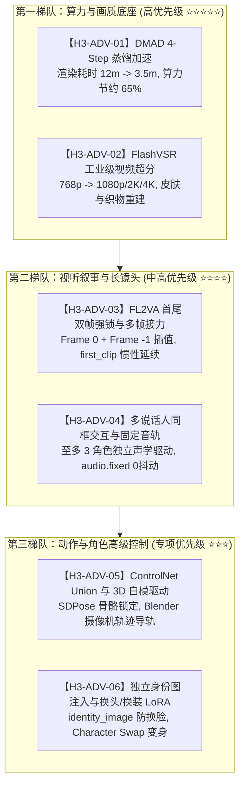

# 专题九：MiniMax H3 高阶能力进阶开发与测试计划

本文档系统规划了 MiniMax H3 尚未在现有管线中启用的核心高阶能力，涵盖 **算力加速、画质超分、首尾双帧闭环、多角色对白、几何动作控制、角色防崩换头** 六大技术专项，明确各专项的 ComfyUI 节点链路、JSON Spec 配置、测试用例与量化验收指标。

---

## 一、 能力规划全景图 (Capability Matrix)



---

## 二、 六大技术专项开发与测试详案

### 专项 1：【H3-ADV-01】DMAD 4-Step 极速推理与算力优化
* **核心目标**：在几乎不损失画质的前提下，将单镜渲染耗时由 ~12 分钟压缩至 **3~4 分钟**，大幅节约 Colab GPU 算力点数。
* **技术原理**：
  - 接入 `dmad_minimax_h3_4step_lora_critic.safetensors`（或 full critic）；
  - 调度器步数由 `steps: 14` 缩减为 `steps: 4`；
  - 注入 `MiniMaxH3SigmaShift` 节点：`shift_video: 12.0`, `shift_audio: 2.0`。
* **JSON Spec 声明规范**：
  ```json
  {
    "duration": 4.5,
    "steps": 4,
    "lora": {"name": "dmad_minimax_h3_4step_lora_critic.safetensors", "strength": 1.0},
    "shift": {"video": 12.0, "audio": 2.0}
  }
  ```
* **测试用例与验收指标**：
  - **测试场景**：以《零零零》S01 走廊背随跟镜复测；
  - **验收指标**：
    1. 单镜（4.5秒，108帧）在 Colab L4 上渲染耗时 $\le 240$ 秒；
    2. 人物面部与大衣边缘无明显伪影或高频噪波。

---

### 专项 2：【H3-ADV-02】FlashVSR 视频超分辨率与高画质增强
* **核心目标**：将 H3 直出的 768×1344 画面重建并无损放大至 **1536×2688 (2K)** 或 **1080×1920 (FHD)**，提升微小细节与质感。
* **技术链路**：
  - 采用 `FlashVSR-v1.1` 开源流式超分架构（Wan2.1 VAE + Streaming DMD）；
  - ComfyUI 流程：`LoadVideo` -> `LQ_proj_in` -> `diffusion_pytorch_model_streaming_dmd` -> `TCDecoder` -> `SaveVideo`；
  - 结合 `face_yolov8m.pt` 做人脸关键区局部精细化（Face Refine）。
* **测试用例与验收指标**：
  - **测试场景**：针对艾玛端坐特写（S03/S04）进行 2X 放大测试；
  - **验收指标**：
    1. 眼睫毛、皮手套纹理、沙发皮质反光清晰锐利；
    2. 无面部闪烁或画面抖动（Temporal Consistency $\ge 0.92$）。

---

### 专项 3：【H3-ADV-03】FL2VA 首尾双帧强锁与多帧惯性延续
* **核心目标**：解决“复杂动作终点漂移”与“镜头拼接启动顿挫”问题。
* **技术链路**：
  - **FL2VA 双帧锁**：加载 `minimax_h3_fl2va_pruned_int8_convrot.safetensors`，同时输入 `first_frame`（起点姿态）与 `last_frame`（终点姿态），通过双向引导实现稳健落座与起身；
  - **`first_clip` 多帧动量继承**：提取上一镜头最后 22 帧切片（`prev_tail22.mp4`），通过 `MiniMaxH3AddGuide(frame_idx=0)` 注入初始速度矢量。
* **JSON Spec 声明规范**：
  ```json
  {
    "first_frame": "s02_start.png",
    "last_frame": "s02_target_end.png",
    "first_clip": "s01_tail22.mp4"
  }
  ```
* **测试用例与验收指标**：
  - **测试场景**：艾玛从站立到完全坐进两具尸体正中间的动作演化；
  - **验收指标**：
    1. 最后一帧必须与 `last_frame` 视觉构图重合度 $\ge 90\%$；
    2. 身体绝不发生悬空漂浮或与两旁尸体穿模融合。

---

### 专项 4：【H3-ADV-04】多说话人同框交互与完全固定音轨驱动
* **核心目标**：摆脱单人独白限制，实现双人/三人同框交替对话，或直接使用外部混音音轨驱动。
* **技术链路**：
  - **多音色交替**：利用 Ref2VA 的 `ref_audios.ref_audio_0` 与 `ref_audio_1`，挂载角色 A 与角色 B 的音色样本；
  - **固定音轨模式**：`audio.fixed` 模式下，直接加载合成好的 48kHz WAV 音频，通过 `VAEEncodeAudio` 冻结音频潜空间，生成完全对齐外部音频的口型与肢体节奏。
* **JSON Spec 声明规范**：
  ```json
  {
    "audio": {
      "voice_refs": [
        {"subject": "emma", "file": "emma_voice.wav"},
        {"subject": "boss", "file": "boss_voice.wav"}
      ]
    },
    "shots": [
      {
        "dialogue": [
          {"subject": "emma", "line": "货款结了。"},
          {"subject": "boss", "line": "你很有胆量。"}
        ]
      }
    ]
  }
  ```
* **测试用例与验收指标**：
  - **测试场景**：艾玛与毒枭头目双人面对面谈判片段；
  - **验收指标**：
    1. 艾玛说话时毒枭紧抿双唇聆听；毒枭说话时艾玛唇部静止，音色分明不混淆。

---

### 专项 5：【H3-ADV-05】ControlNet Union 与 3D 白模动作导轨
* **核心目标**：针对高难度武打、舞蹈、持枪战术移动，提供绝对精准的空间几何与骨骼控制。
* **技术链路**：
  - 部署 `minimax_h3_fun_controlnet_union_2.0_pruned_int8_convrot.safetensors`；
  - 配合 `sdpose_wholebody_fp16.safetensors` 进行全身体态姿势控制；
  - 或通过 Blender 制作简易低模假人（White Model）导出视频，在 Prompt 中标记 `<Video 1> is ONLY a motion reference`。
* **测试用例与验收指标**：
  - **测试场景**：两名保镖拔枪戒备与侧身掩护动作；
  - **验收指标**：
    1. 手臂持枪角度与骨骼姿态完全一致，无多指与肢体扭曲。

---

### 专项 6：【H3-ADV-06】独立身份图注入与角色换装/换头 LoRA
* **核心目标**：解决大角度运镜（如 180° 环绕）导致的角色“换脸”失真，支持已有视频资产的无缝换角。
* **技术链路**：
  - **多图身份注入**：首帧之外挂载 `identity_image`（`<Picture 2>` 艾玛正脸肖像卡）；
  - **换头/换装 LoRA**：挂载 `minimax_h3_head_swap_v1.0_r32.safetensors` 或 `minimax_h3_character_swap_v1.1_ref2va_fro.safetensors`。
* **测试用例与验收指标**：
  - **测试场景**：从背后 180 度大环绕至正面特写；
  - **验收指标**：
    1. 面部转正后，金发特征、眼球颜色与肖像卡保持高度一致。

---

## 三、 测试排期与推进路线 (Schedule)

| 阶段 | 计划周期 | 核心测试任务 | 预期产出与里程碑 |
| :--- | :--- | :--- | :--- |
| **Sprint 1** | **第 1 周** | 1. 接入 DMAD 4-step 蒸馏推理（H3-ADV-01）<br>2. 接入 FlashVSR 2X 超分（H3-ADV-02） | 单镜渲染时间压至 3.5 分钟；输出首支 2K 超清接力长镜头样片 |
| **Sprint 2** | **第 2 周** | 1. 测试 FL2VA 首尾双帧强制闭环（H3-ADV-03）<br>2. 验证多说话人交替对白（H3-ADV-04） | 跑通复杂大幅度落座闭环与双人对嘴实战用例 |
| **Sprint 3** | **第 3 周** | 1. 挂载 identity_image 多图肖像防崩（H3-ADV-06）<br>2. 接入 Fun ControlNet Union 骨骼控制（H3-ADV-05） | 跑通 180° 大环绕运镜与战术动作精确控制 |
