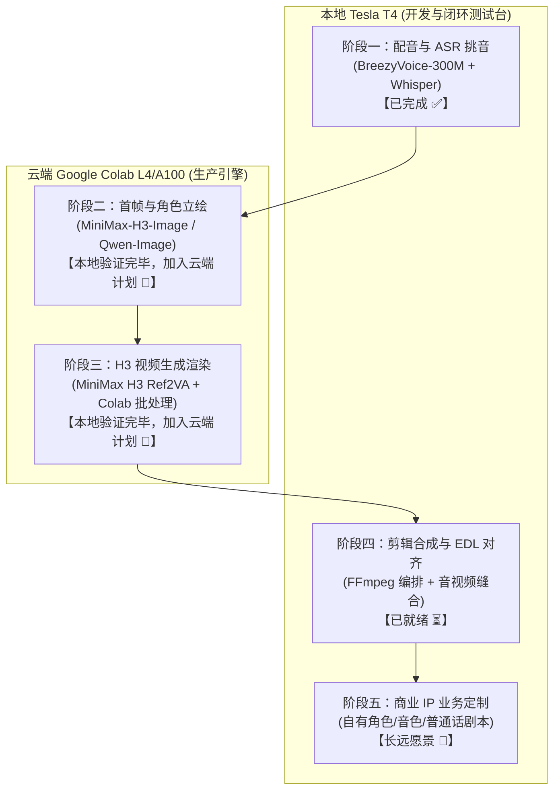

# 项目总体开发计划与路线图 (Roadmap)

本文档规划本工作流项目的长期定制目标、实施原则以及分阶段实施路线。

---

## 一、 总体愿景与核心原则

### 1. 最终目标
将现有的原作者短剧自动化生成管线（原山狮霸工作流），逐步重构并改造为**适合用户自身业务与角色设定**的自动化/半自动化影视短片内容生产工作流。

### 2. 铁律实施原则
> **“先搭好运行环境并完整运行一遍，确保全链路跑通，再执行定制化改造。”**
> 
> 在对剧本、角色、风格或业务逻辑进行大规模二次开发前，必须保证：
> 1. 原工作流的各个关键模块（配音、首帧画图、视频生成、后期剪辑）在当前计算环境中全部具备可执行条件；
> 2. 选取一个极简标准样片跑通端到端全流程（从分镜文字到最终输出成片 MP4）；
> 3. 在验证链路通畅、确认基础设施可用后，再稳步引入个性化定制。

---

## 二、 阶段里程碑规划

---

### 阶段一：本地配音与 ASR 挑音模块（已完成 ✅）
* **目标**：解决中文/台湾国语台词的高质量离线合成与自动质检挑音，解除 Windows 依赖，实现 Linux/Docker 容器化运行。
* **交付内容**：
  - 基于 PyTorch 2.4.1 + CUDA 12.4 构建 `lopy-voice:latest` 容器镜像。
  - 宿主机 `models/` 目录挂载与模型权重持久化（BreezyVoice-300M、G2PW、Faster-Whisper large-v3）。
  - 提供宿主机 CLI 包装脚本 `tools/docker_voice.sh`，支持 `all`、`batch`、`pick`。
  - 容错机制增强：Edge-TTS 网络异常自愈与降级机制。
* **验收结果**：14秒完成单句生成与质检，显存峰值仅 2.14GB。

---

### 阶段二：首帧与角色图像生成模块（本地已验证，推进云端 MiniMax-H3-Image 🚀）
* **硬件策略**：
  - **本地 T4**：作为零成本校验台（已完成 Qwen-Image 角色卡 `yun.png` 与首帧 `s1.png` 闭环验证）。
  - **云端 Colab L4/A100**：作为极速批量生产引擎。
* **技术路线与模型升级**：
  - **基线方案**：Qwen-Image-Edit 2511 fp8 mixed（已跑通，单帧耗时较长）。
  - **升级方案（重点纳入计划）**：**MiniMax-H3-Image**（33.1B DiT 开源模型，支持 1~16 张参考图多图锁定角色，蒸馏极速推理 ~10 秒，官方 ComfyUI 节点支持）。
* **画面规格**：**9:16 竖屏短视频构图**（原生 768×1344），面向抖音/视频号/TikTok/Shorts。
* **计划执行项**：
  - 在 Colab 部署环境中接入 `Comfy-Org/MiniMax-H3-Image`。
  - 评测 MiniMax-H3-Image 在 9:16 构图下多图参考（角色卡+场景参考）的人脸锁定稳定性与渲染速度。

---

### 阶段三：视频与对嘴生成模块（本地已验证，推进 Colab 批量渲染 🚀）
* **硬件策略**：
  - **本地 T4**：首个 3 秒竖屏测试片段已成功生成（`clip.mp4`，显存仅 9.61GB，证明工作流完全可行）。
  - **云端 Colab**：正式成片与多镜渲染由 Colab L4 (24GB) / A100 接管，单镜耗时从 87 分钟压缩至 **1.5~2.5 分钟**。
* **主要工作与计划交付**：
  - **Colab 一键式运行资产**：已就绪 [colab_lopy_pipeline.ipynb](file:///home/debian/lopy_project/lopy-workflow-colab/colab_lopy_pipeline.ipynb) 与 [cloud/colab_setup.sh](file:///home/debian/lopy_project/lopy-workflow-colab/cloud/colab_setup.sh)。
  - **云端批处理管线**：支持单镜/多镜任务（S01~S04）一次性上传、并行渲染并打包回传本地 `runtime/outputs/`。
  - **模型持久化方案**：支持直接挂载 Google Drive，避免每次开机重复拉取 42GB 权重。
* **验收标准**：通过 Colab L4 在 10 分钟内完成 4 镜短剧的全部视频生成。

---

### 阶段四：后期剪辑、音效与端到端样片试跑（进行中 ⏳）
* **目标**：将所有分镜视频、对白配音、BGM/音效、字幕自动串接合成最终完整成片。
* **主要工作**：
  - 基于 `runtime/` 统一工作空间执行 FFmpeg 合成流水线（镜头拼接、音量平缩、开场与片尾）。
  - 测试字幕自动生成或对齐工具（基于 Whisper 时间戳）。
  - 运行 `demo_local` 完整样例短片并输出最终成片。
* **验收标准**：全自动化产生第一支可播放、声画对齐的测试成片 MP4。

---

### 阶段五：面向自身业务的全面定制改造（长远愿景 🎯）
* **目标**：将项目改造成完全符合自身业务需求的原创短视频工作流。
* **主要工作**：
  - **语言与文本**：全项目代码注释、文档与 Prompt 统一规范为简体中文（基础转换已完成）。
  - **角色与世界观**：替换原版“山狮霸”师生 IP，建立用户自己的角色卡、音色特征与视觉资产库。
  - **剧本与分镜**：接入定制化的 LLM 剧本创作技能或模版。
  - **发布与归档**：按用户发布渠道（短视频 9:16 或横屏 16:9）定制渲染模版与分辨率。
