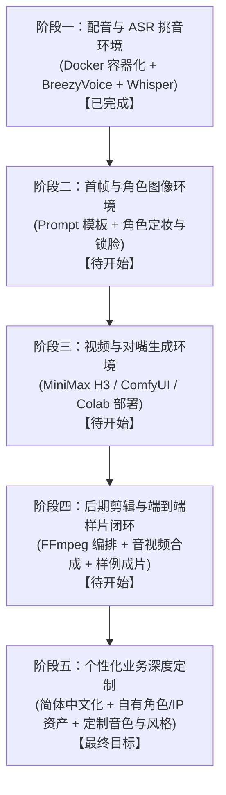

# 项目总体开发计划与路线图 (Roadmap)

本文档规划本工作流项目的长期定制目标、实施原则以及分阶段实施路线。

---

## 一、 总体愿景与核心原则

### 1. 最终目标
将现有的原作者短剧自动化生成管线（原山狮霸工作流），逐步重构并改造为**适合用户自身业务与角色设定**的自动化/半自动化影视短片内容生产工作流。

### 2. 铁律实施原则
> **“先搭好运行环境并完整运行一遍，确保全链路跑通，再执行定制化改造。”**
> 
> 在对剧本、角色、风格或业务逻辑进行大规模二次开发前，必须保证：
> 1. 原工作流的各个关键模块（配音、首帧画图、视频生成、后期剪辑）在当前计算环境中全部具备可执行条件；
> 2. 选取一个极简标准样片跑通端到端全流程（从分镜文字到最终输出成片 MP4）；
> 3. 在验证链路通畅、确认基础设施可用后，再稳步引入个性化定制。

---

## 二、 阶段里程碑规划

---

### 阶段一：本地配音与 ASR 挑音模块（已完成 ✅）
* **目标**：解决中文/台湾国语台词的高质量离线合成与自动质检挑音，解除 Windows 依赖，实现 Linux/Docker 容器化运行。
* **交付内容**：
  - 基于 PyTorch 2.4.1 + CUDA 12.4 构建 `lopy-voice:latest` 容器镜像。
  - 宿主机 `models/` 目录挂载与模型权重持久化（BreezyVoice-300M、G2PW、Faster-Whisper large-v3）。
  - 提供宿主机 CLI 包装脚本 `tools/docker_voice.sh`，支持 `all`、`batch`、`pick`。
  - 容错机制增强：Edge-TTS 网络异常自愈与降级机制。
* **验收标准**：通过 `tests/voice_test/jobs.json` 批次生成音频，Faster-Whisper 成功在 GPU (CUDA) 听写打分并自动裁切静音，输出最终可用音频。

---

### 阶段二：首帧与角色图像生成模块（待开始 ⏳）
* **目标**：搭建角色与场景首帧生成链路，保证画面构图与角色面部一致性。
* **主要工作**：
  - 梳理首帧生成脚本与配置（OpenAI Image 2.5 API 或本地 Flux/SDXL/Qwen-Image 模型）。
  - 角色资产卡规范化（提示词模板、定妆图、表情与机位控制）。
  - 准备基础测试分镜描述，测试图像生成并验证尺寸与通道标准（16:9，1920x1080 / 1280x720）。
* **验收标准**：输入镜头描述文本，能够稳定生成高一致性的角色与场景图片。

---

### 阶段三：视频与对嘴生成模块（待开始 ⏳）
* **目标**：跑通以首帧图片 + 配音音频作为输入，生成带唇形同步的动态视频片段。
* **主要工作**：
  - 评估与搭建视频生成环境：MiniMax H3（本地 ComfyUI 运行或 Google Colab GPU 环境）。
  - 配置 `cloud/run_h3.sh` 或本地批处理调度，确保显存分配合理。
  - 验证基于参考音频与首帧图像生成 2-4 秒对嘴动态视频镜头。
* **验收标准**：输入单句音频与首帧，输出唇形贴合、动作自然的视频片段。

---

### 阶段四：后期剪辑、音效与端到端样片试跑（待开始 ⏳）
* **目标**：将所有分镜视频、对白配音、BGM/音效、字幕自动串接合成最终完整成片。
* **主要工作**：
  - 配置 FFmpeg 合成流水线（镜头拼接、音量平缩、开场与片尾）。
  - 测试字幕自动生成或对齐工具。
  - 选取一个 10-30 秒、包含 2-3 个镜头的极简测试剧本，从头到尾一键全流程跑通。
* **验收标准**：全自动化产生第一支可播放、声画对齐的测试成片 MP4。

---

### 阶段五：面向自身业务的全面定制改造（长远愿景 🎯）
* **目标**：将项目改造成完全符合自身业务需求的原创短视频工作流。
* **主要工作**：
  - **语言与文本**：将全项目文案、注释与默认提示词规范为简体中文。
  - **角色与世界观**：替换原版“山狮霸”师生 IP，建立用户自己的角色卡、音色特征与视觉资产库。
  - **剧本与分镜**：接入定制化的 LLM 剧本创作技能或模版。
  - **发布与归档**：按用户发布渠道（短视频 9:16 或横屏 16:9）定制渲染模版与分辨率。
