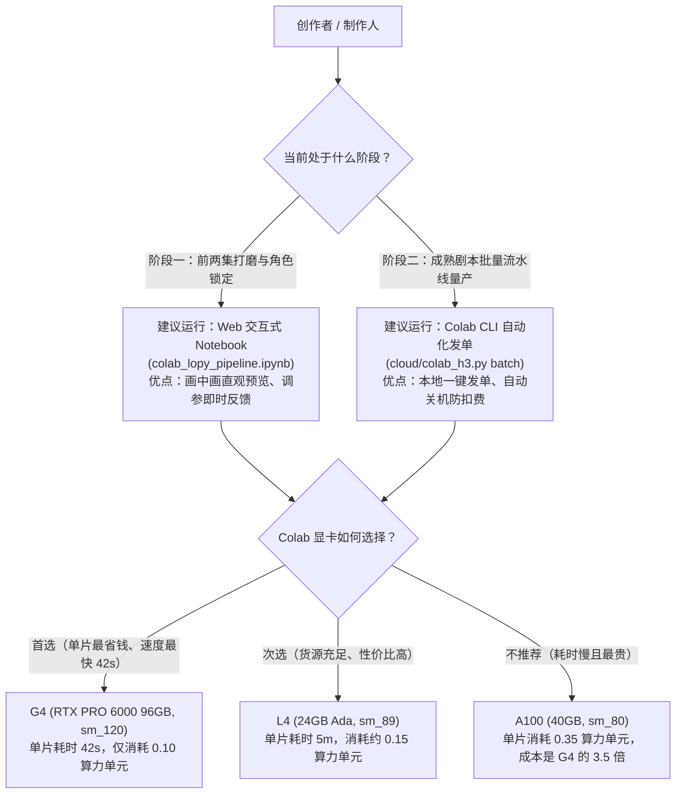

# LoPy 运行建议与混合架构决策指南 (Runtime Recommendations)

本文档子目录专为 LoPy 项目在不同算力条件（本地 GPU、Google Colab 云端）、不同生产阶段（初期样片调试 vs 后期批量量产）下的**运行策略、硬件选型与成本控制**提供权威建议。

---

## 一、 核心决策导图 (Decision Map)

---

## 二、 专题建议文档索引

我们将不同维度的运行建议按类型拆分，方便随时专项查阅：

| 专题文件 | 文件链接 | 核心建议摘要 |
| :--- | :--- | :--- |
| **01. 混合算力分工建议** | [01_local_vs_colab_hybrid.md](file:///home/debian/lopy_project/lopy-workflow-colab/docs/runtime_recommendations/01_local_vs_colab_hybrid.md) | **为什么不能盲目照搬原作者配置？** 对比原作者 5090 (32G) 与本地 T4 (16G) 实测，确立「本地跑配音/剪辑，云端跑生图/视频」的黄金分割架构。 |
| **02. 云端显卡选型与成本** | [02_colab_gpu_cost_efficiency.md](file:///home/debian/lopy_project/lopy-workflow-colab/docs/runtime_recommendations/02_colab_gpu_cost_efficiency.md) | **反直觉的 G4 算力秘密**：揭秘为什么租用单价最贵的 G4 显卡，单片综合成本反而比 L4/A100 低 60% 以上。 |
| **03. 交互模式演进建议** | [03_cli_vs_web_workflow.md](file:///home/debian/lopy_project/lopy-workflow-colab/docs/runtime_recommendations/03_cli_vs_web_workflow.md) | **Web 网页端 vs CLI 命令行**：初期调试选 Web 画中画直观定稿，后期量产选 CLI 自动开机关机、无人值守批量出片。 |
| **04. 审查铁律与人机协同** | [04_human_review_gates.md](file:///home/debian/lopy_project/lopy-workflow-colab/docs/runtime_recommendations/04_human_review_gates.md) | **硬性强制铁律（非软性建议）**：首帧未审严禁启渲、算法达标静默放行、跑完即关机零闲置扣费。 |
| **05. 全链路生命周期规划** | [05_execution_pipeline_and_session_lifecycle.md](file:///home/debian/lopy_project/lopy-workflow-colab/docs/runtime_recommendations/05_execution_pipeline_and_session_lifecycle.md) | **执行逻辑与生命周期新规划**：双模式（离线解耦 vs 5分钟保底连续）、GPU 分级调度（首帧 L4、视频 G4 极速降本）、2×2 拼图画廊核验机制。 |
